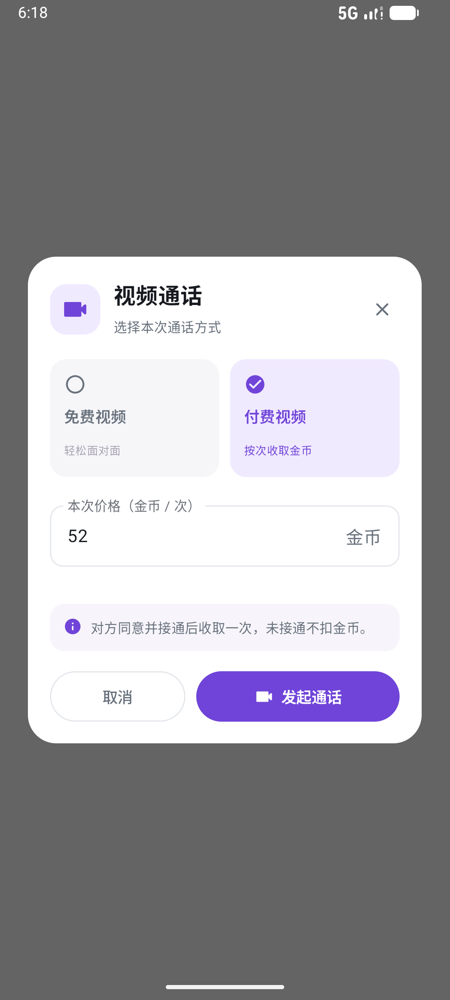
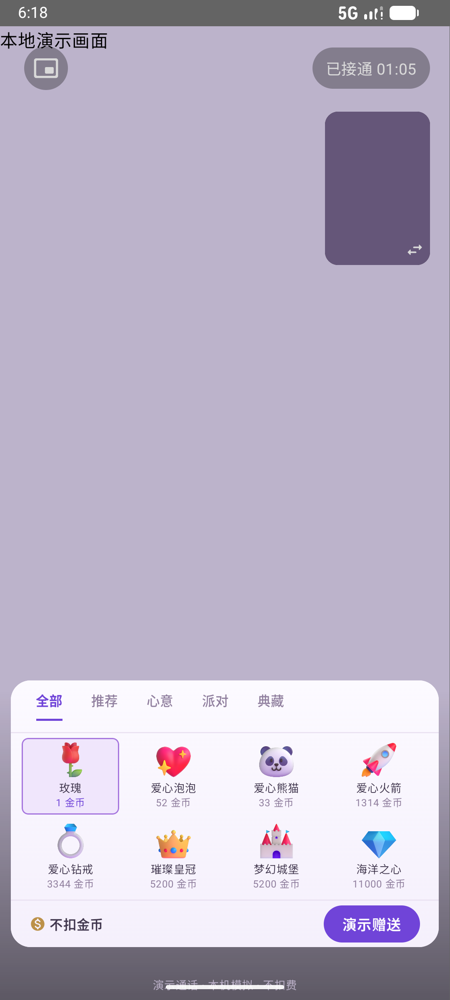

# 现场前台与网页后台检查记录

检查日期：2026 年 11 月 13 日。本记录针对本地运行的安卓应用、网页后台及配套服务；通过的项目不代表所有设备、网络和第三方服务均已验收。

最终已将 0.1.238 安装到模拟器并重新打开应用，自动更新服务已恢复。

## 已完成的修改

1. 通话送礼面板上移，完整露出余额和赠送按钮，保留浅色、两排礼物及分类滚动。点击面板外部空白处或返回键可收起，通话继续；面板内部选择礼物不会触发关闭。
2. 视频通话选择框改为白色与紫色的圆角卡片，区分免费／付费；未认证用户无法选择付费，空价格及 0 金币无法发起付费通话。
3. 修复本地 MariaDB 不支持资金流程中 `FOR SHARE` 的问题，提现及退款改用兼容的共享锁语法。
4. 修复私信礼物、付费视频、视频通话、付费直播观看收益未计入可提现余额的问题。余额展示与提现校验共用收益计算，已有提现继续占用额度。
5. 本地应用服务补接通知设置、认证状态路由，修复这两个入口返回 404 的问题。
6. 修复 Android 8／9 等旧系统上的版本号读取和大整数换算兼容性；直播播放器改用安全的 Activity 获取方式，并明确声明播放器非稳定接口的使用。
7. 修正三项过期的服务端测试夹具。逐处确认 `produceState` 均有赋值后，仅对相关函数标注旧版 Compose 检查器的误报；未关闭全局检查。

服务端相关源码及测试已同步至 `upstream-overlays`。

## 验证结果

| 项目 | 结果 | 覆盖内容 |
| --- | --- | --- |
| 安卓单元测试 | 63 通过，0 失败 | 通话回执、消息、礼物、金额换算、房间、邀请、播放等现有测试 |
| 应用网关测试 | 43 通过，0 失败，1 跳过 | 登录会话、权限、动态审核／评论、关注、私信、支付接口边界及媒体权限 |
| 收益服务测试 | 73 通过，0 失败，4 跳过 | 收益归集、并发提现预留、退款、重复请求、审核、账务及排行榜 |
| 前台读取接口 | 62 通过，0 失败 | 动态／视频分栏、评论、互动、资料、关系、钱包、收入来源、等级、公告、榜单等 |
| 后台读取接口 | 29 通过，0 失败 | 用户、直播、礼物、动态审核、配置、资金记录与审核等 |
| 通话界面设备检查 | 通过 | 免费／付费选项、认证限制、价格校验；礼物面板底部位置、选择、外部点击、返回键、重新打开和模拟赠送 |
| 静态类型检查 | 前后端通过 | 网页后台及应用服务 TypeScript |
| 安卓静态检查 | 0 错误，45 警告 | 余下主要为旧接口、资源及性能建议，未声称全部清零 |
| 安卓构建 | 调试版与正式版编译通过 | 正式版为未签名安装包，未发布到应用商店 |

设备检查使用专用调试页面和本地假回调，无真实通话、消息、送礼或扣款。可提现余额回归测试在隔离数据库验证：私信等各来源合计 76 单位收益，提现 76 成功，重复请求不重复预留，再提现 1 被拒绝；未完成结算的直播收益不提前计入。

## 网页后台检查

已登录并逐页打开用户、直播、公告、小秘书、动态审核、贵族权益、礼物、主播收益、充值、提现、退款、等级、邀请及处置等管理页面。礼物编辑可显示图片及推荐／心意／派对／典藏分类；动态管理可查看发布的实际文字及媒体预览。

检查了 1366×900 桌面尺寸及 390×844 手机尺寸。手机菜单可展开、收起及切换页面，检查完成后已恢复默认窗口尺寸。未保存运营配置或执行真实审核、充值等操作。

## 仍需接入环境后验证

- 1 项 LiveKit 真实信令检查，以及 4 项 Redis／Kafka 投影与重启检查，因本机对应服务未启动而跳过。
- 真实两台设备的音视频通话、直播推流、弱网及后台恢复尚需联调，模拟画面不作为真实媒体连通证明。
- 邮箱发送服务按现有安排尚未配置；未验证真实邮件收取。
- 真实充值、提现打款、实名服务未执行，资金功能使用隔离测试库验证。
- 本次未完成所有安卓机型的逐像素检查，也未宣称软件完全没有问题。

## 可复查的记录

- `.local/full-qa-android-retest.log`、`.local/full-qa-final-build.log`
- `.local/full-qa-call-ui.log`
- `.local/full-qa-server-retest.log`
- `.local/full-qa-revenue-retest.jsonl`
- `.local/full-qa-app-smoke.log`、`.local/full-qa-admin-smoke.log`
- 前台接口复查脚本：`scripts/verify-app-local.cjs`，复用已登录测试账号，仅查询界面数据。
- 通话界面设备检查：`app/src/androidTest/java/cn/liveroom/app/DirectCallDeviceCheck.kt`，专用页面仅存在于调试构建。

